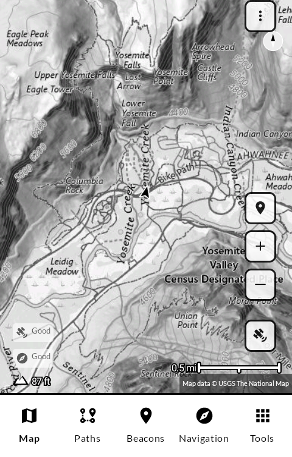
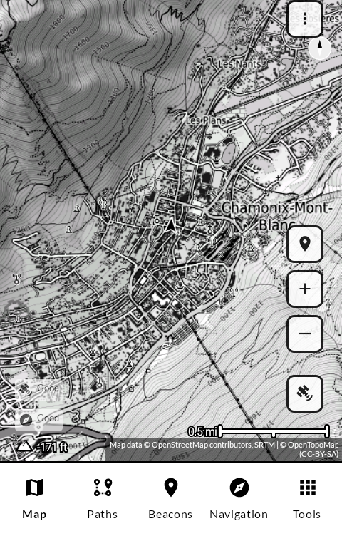
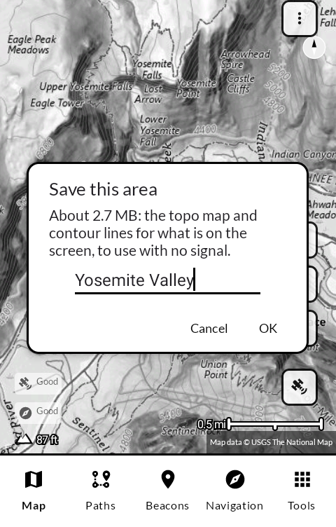
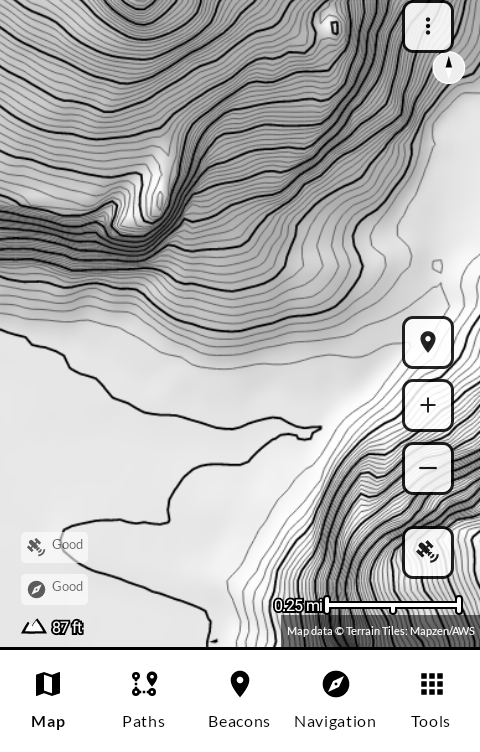

# Topo

地形 *chikei*

Topographic maps for the trail on an E Ink phone: contours, public land, forest roads,
trails and lot lines, drawn in black and white like a paper quadrangle, and there with no
signal.

*Chikei* is the lie of the land: the ordinary word for the shape of the ground a topo map
sets out to show.

Built for the [Mudita Kompakt](https://mudita.com/products/kompakt/), whose 4.3" panel has
sixteen greys, a slow redraw, and is read on a ridge as often as at a desk.

## Screenshots

| | | | |
|---|---|---|---|
|  |  |  |  |

## What it shows

The map works as soon as it is installed, with nothing to set up:

- **USGS topo** from The National Map in the United States: the familiar quadrangle, with
  contours, trails, forest roads and names.
- **OpenTopoMap** everywhere else: a topo map drawn from OpenStreetMap, with contours and hill
  shading.
- **Contour lines anywhere**, drawn on the phone from open elevation data (the Terrain Tiles),
  over a faint hill shade, wherever neither map has a tile, or there is no signal. The same
  elevation feeds the elevation readout and a track's elevation profile.

Region packs from a server of your own, if you run one, draw over all of this and show more:

- **Contours** from the region's elevation model. In the US they come from 3DEP's lidar where
  it has it, in feet: every 40 with every 200 labelled when zoomed out, and every 20 with every
  100 labelled close in, like a 20 ft USGS quad. Elsewhere they are in metres (every 20 and
  100, then every 10 and 50)
- **Public land** as a light grey tint with its boundary: national forests, BLM land, national
  and state parks, wildlife areas, state trust land and local parks. Private land stays white;
  tribal land is outlined but not tinted, since it is not public land
- **Lot lines** on private land, where a state or county publishes them
- **Forest roads** with their numbers, and **Forest Service trails** by name
- Everything OpenStreetMap knows: roads, tracks, paths, water, peaks, places, and the
  boundaries of parks and reserves anywhere in the world

## What it does

- **Save this area**, in the map's menu, keeps what is on the screen for use with no signal:
  the USGS topo map (in the US) and the elevation for contour lines (anywhere). It shows the
  size first; an area over 200 MB is refused, with a note to zoom in. Saved areas are listed,
  with their sizes, under Settings > Map > Saved areas, where a second tap deletes one.
  OpenTopoMap's tiles are never saved, since its rules forbid downloading for offline use;
  what you looked at recently may still show from the phone's cache.
- **With no signal** the map shows, in order: your region packs, saved areas' topo maps,
  saved areas' contour lines, then whatever tiles are still in the cache.
- **Settings > Map > Map** picks the map: Automatic (USGS in the US, OpenTopoMap elsewhere),
  USGS only, OpenTopoMap only, or **My region packs only**, which keeps the map off the network
  altogether.
- **Download region** shows the regions on the server as squares on a map: USGS 7.5-minute
  quadrangles in the US, and elsewhere 1/8-degree squares named after the largest place in
  each.
  Tap the squares you need; each comes with its own elevation, and neighbours join without
  a seam.
- **Here**, on the map: mark where you are standing, or start and stop recording your track.
- **Hold a finger on the map** to see whose land it is, as far as the region's records go:
  the park, forest or reserve and who holds and manages it; the owner of record of a private
  lot; a conservation easement and its holder; wilderness and other designations laid over
  it; and whether the public may enter. Where nothing is recorded it says so. Beneath that,
  how steep the ground is, which way it faces, and its UTM coordinate.
- **Track detail** sets how closely a recording follows you: a point a minute, or every 30,
  10 or 5 seconds.
- **Call for help from here**: with Field Kit installed, the last item under Here opens Field
  Kit's "Calling for help" page with your position on it, ready to read out or send.
- **Share GPX** hands a recorded track to CalTopo, or to anything else that takes GPX.
- **Open a GPX file** from [Files](https://github.com/wanderwildwood/tana) or an attachment,
  and Topo offers its paths to import; a file of waypoints alone becomes beacons.
- **Forage**, a layer added from the map's Layers > Additional layers, shows fruit and nut
  trees and shrubs nearby: trees and shrubs from OpenStreetMap, and, in builds with a Falling
  Fruit key, the spots on [Falling Fruit](https://fallingfruit.org), the open map of edible
  plants. Both go through one list of plants grown or foraged for their fruit, berries or nuts
  (apples, plums, mulberries, walnuts, hazels, brambles and so on), so city maps are not
  crowded with the maples, oaks and lindens Falling Fruit also counts. Tap one for its
  name, season and access notes where they are known, and where the record comes from. Where
  the two sources hold the same tree it shows once, with Falling Fruit's notes. Zoomed out,
  Falling Fruit's counts stand in for the spots. What it fetched is kept for a month, so the
  layer works with no signal where you have already looked, and Save this area keeps the
  area's spots too. Mushrooms are never shown: Topo does not say what is safe to eat. Check
  before you pick: some spots are on private land or gone.
- Navigate to a marked place, with distance, bearing and elevation.
- **User guides** (hold a finger on a tool): their text can be selected and a word sent to a
  dictionary app such as Define, which waits behind a ⋮ on the selection bar.

## What it needs

- **Location**, to put you on the map and record tracks. It stays on the phone.
- **Internet**, only to fetch map tiles and elevation, while the map is open or when you save
  an area; fruit and nut trees for the area on screen, while the Forage layer is on; and region
  packs from a server you set, when you ask. See [PRIVACY.md](PRIVACY.md).
- **A map server of your own: optional.** Region packs add public land, lot lines and forest
  roads offline. They are plain files built by the scripts in [`mapdata/`](mapdata) from public
  data and served by anything that serves files: `tailscale serve`, nginx, a folder on a web
  host. Offline Maps > + > Download region asks for the server's address.

## What it does not do

- It does not route. It shows the ground, and you choose the way.
- It does not replace a paper map and a compass.
- It does not send your location anywhere. There is no account and no analytics.

## On a Mudita Kompakt

DuraSpeed, a MediaTek service on the Kompakt, closes installed apps a few minutes after the
screen goes dark and keeps them closed until they are opened again. For Topo that means a track
recorded with the screen off can stop partway. Mudita's own apps are on its allow list; this one
has to be added, once.

Kompakt's Settings has no way in to DuraSpeed: no menu entry, and no search box to look for it
in. Its own screen will not open for another app either, but its App info page will. Messaging
and Whereabouts each have a button that goes there; without either, from a computer with `adb`:

    adb shell am start -a android.settings.APPLICATION_DETAILS_SETTINGS -d package:com.mediatek.duraspeed

Then, on the phone:

1. Tap **Open** on DuraSpeed's App info page.
2. Switch **Topo** on in the list. **On means allowed** to run in the background, which is
   easy to read the wrong way round. Switching DuraSpeed off at the top works too, for every app.

## Getting it, and keeping it

Download <https://github.com/wanderwildwood/chikei/releases/latest/download/chikei.apk> and
sideload it. That address always points at the newest release, and every release publishes a
`.sha256` beside the APK if you would rather check than trust.

For updates without doing this by hand, add this repository to
[Obtainium](https://github.com/ImranR98/Obtainium):

    https://github.com/wanderwildwood/chikei

**The application id is settled**: updates install over what you have, keeping your maps,
tracks and marks.

## Building

```
./gradlew assembleRelease
```

A release is signed by a keystore in `signing/`, which is not in this repository. Without
it the release APK builds **unsigned** and will not install anywhere; there is no fallback
key by design.

### Building regions

```
mapdata/fetch.py <west> <south> <east> <north> <area> [--sources a,b,...]   # data for an area
mapdata/build_cells.py <area> <cells>                                       # one pack per cell
mapdata/publish.py <site> <cells>/*/                                        # a static site with packs.json
```

They need Python 3 with numpy, shapely, rasterio and contourpy, and
[osmosis](https://github.com/openstreetmap/osmosis) with the
[Mapsforge map writer](https://github.com/mapsforge/mapsforge) plugin. Nothing needs an
account or a key.

Each kind of data is a **source**. An area in the United States takes the US sources, and
anywhere else takes the world ones; `--sources` picks your own.

| Source | Where | What it adds |
|---|---|---|
| `usfs` | US | national forests' own ownership, roads and trails ([USDA Forest Service](https://data.fs.usda.gov/geodata/edw/)) |
| `padus` | US | all public and protected land, with owner, manager, easements, wilderness and other designations, and public access ([USGS PAD-US](https://www.usgs.gov/programs/gap-analysis-project/science/pad-us-data-overview)) |
| `tribal` | US | reservations, off-reservation trust land and Hawaiian home lands ([Census TIGER](https://tigerweb.geo.census.gov/)) |
| `parcels` | US | county lots with the owner of record, from each service listed in `PARCELS` in `fetch.py` whose area meets yours |
| `wdpa` | world | national parks, reserves and other protected areas, with their designation and managing body ([Protected Planet](https://www.protectedplanet.net/)) |
| `quads` / `grid` | US / world | how the area is cut into packs |
| `osm` | both | OpenStreetMap, from the smallest [Geofabrik](https://download.geofabrik.de/) extracts that cover the area |
| `dem` | both | elevation: [USGS 3DEP](https://www.usgs.gov/3d-elevation-program) 10 m in the US, [Copernicus GLO-30](https://spacedata.copernicus.eu/collections/copernicus-digital-elevation-model) elsewhere |

**Parcels** are published county by county and state by state, and many do not publish
owners at all. North Carolina's statewide service is listed; to add your own county, put its
ArcGIS parcel layer, the name of the field holding the owner, and its bounds in `PARCELS`. Only
the outline and the owner are ever fetched: never mailing addresses or values.

**Terms.** PAD-US, TIGER, 3DEP and the Forest Service's data are public domain;
OpenStreetMap is ODbL. Copernicus DEM is free to use with its credit, which each pack carries.
WDPA is free for personal and non-commercial use; before serving packs built with it to the
public, read [its terms](https://www.protectedplanet.net/en/legal).

Each pack is three files: the Mapsforge map, the elevation, and a small land file saying
whose land each part of the cell is (see `mapdata/land_pack.py`). The app knows nothing of
any one country's agencies; it says what the land file says.

## Credit

Maps with no setup: **USGS The National Map** (public domain; "Map services and data available
from U.S. Geological Survey, National Geospatial Program"). **OpenTopoMap** (CC-BY-SA): map data
© OpenStreetMap contributors, SRTM; map style © OpenTopoMap. **Terrain Tiles** by Mapzen, on the
[AWS Registry of Open Data](https://registry.opendata.aws/terrain-tiles/), with their sources
credited as [their documentation](https://github.com/tilezen/joerd/blob/master/docs/attribution.md)
asks: 3DEP (formerly NED), GMTED2010 and SRTM courtesy of the U.S. Geological Survey; ETOPO1,
U.S. National Oceanic and Atmospheric Administration; EU-DEM, produced using Copernicus data and
information funded by the European Union; ArcticDEM, created from DigitalGlobe, Inc. imagery and
funded under National Science Foundation awards 1043681, 1559691 and 1542736; © Commonwealth of
Australia (Geoscience Australia) 2017; Canada, contains information licensed under the Open
Government Licence – Canada; Mexico, INEGI, Continental relief, 2016; New Zealand, Crown
copyright Land Information New Zealand and the New Zealand Government; Norway, © Kartverket;
United Kingdom, © Environment Agency copyright and/or database right 2015; Austria, © offene
Daten Österreichs – Digitales Geländemodell (DGM) Österreich. The outline of the US that picks
between USGS and OpenTopoMap is from [Natural Earth](https://www.naturalearthdata.com/) (public
domain).

Forage: trees from © OpenStreetMap contributors (ODbL), through the
[Overpass API](https://overpass-api.de/), or, when that server is busy, the public instance
run by [Private.coffee](https://overpass.private.coffee/). Edible plant locations from
[Falling Fruit](https://fallingfruit.org) and its sources, under each dataset's licence (mostly
ODbL).

After [Trail Sense](https://github.com/kylecorry31/Trail-Sense) by Kyle Corry, which this
is: its sensors, paths, beacons, navigation and Mapsforge rendering are Trail Sense's, cut
down to the map and what you do with it. Trail Sense is under the MIT License, kept in
[`LICENSES/MIT-Trail-Sense.txt`](LICENSES/MIT-Trail-Sense.txt).

Map data © OpenStreetMap contributors (ODbL). In the US: public and protected land from USGS
PAD-US, national forests, forest roads and trails from the USDA Forest Service, tribal land
from the US Census Bureau, elevation and quadrangles from the USGS, and parcels from the
states and counties that publish them. Elsewhere: protected areas from UNEP-WCMC and IUCN,
Protected Planet (WDPA), and elevation from Copernicus DEM GLO-30, © DLR e.V. 2010-2014 and
© Airbus Defence and Space GmbH 2014-2018, provided under COPERNICUS by the European Union
and ESA.

## Licence

GPL-3.0-only. See [LICENSE](LICENSE).

Copyright (C) 2026 wander wildwood

This program is free software: you can redistribute it and/or modify it under the terms of
the GNU General Public License as published by the Free Software Foundation, version 3.

This program is distributed in the hope that it will be useful, but WITHOUT ANY WARRANTY;
without even the implied warranty of MERCHANTABILITY or FITNESS FOR A PARTICULAR PURPOSE.
See the GNU General Public License for more details.

You should have received a copy of the GNU General Public License along with this program.
If not, see <https://www.gnu.org/licenses/>.

A map you carry into the woods should stay free to fix and share, so the changes made here
are copyleft. Trail Sense's own code keeps its MIT licence.
